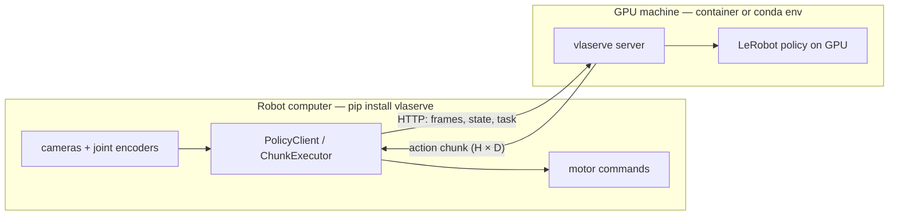

# Getting started

There are two halves, and they usually live on different computers:



They can also be the same computer: then the URL is `http://127.0.0.1:11450`.

## 1. Get the server

=== "Container (recommended)"

    ```bash
    git clone https://github.com/mtbui2010/vlaserve && cd vlaserve
    make docker                      # builds vlaserve:gpu-cu128 (≈ 8.5 GB)
    ```

    Needs Docker with the NVIDIA container toolkit, and an NVIDIA driver that supports
    CUDA ≥ 12.8 (driver ≥ 570). Older driver: `make docker TORCH_CUDA=cu126`.

=== "Conda environment"

    ```bash
    git clone https://github.com/mtbui2010/vlaserve && cd vlaserve
    make env                         # conda env "vlaserve": Python 3.12, torch cu128, LeRobot 0.6.1
    ```

    `make env` installs torch from the CUDA-specific index **first**. If you just
    `pip install lerobot`, pip may pick a torch built for a newer CUDA than your driver, and
    `torch.cuda.is_available()` silently returns `False`.

## 2. Look at a model before loading it

`inspect` reads only the small metadata files, so it is instant and needs no GPU:

```bash
make inspect MODEL=lerobot/pi05_libero_finetuned
```

```json
{
  "license": "gemma-terms",
  "license_warning": "licence 'gemma-terms' is not permissive. PaliGemma derivative: ...",
  "spec": {
    "policy_type": "pi05",
    "cameras": {"image": [3, 256, 256], "image2": [3, 256, 256]},
    "state_dim": 8,
    "action_dim": 7,
    "chunk_size": 50,
    "n_action_steps": 50,
    "language": true,
    "source": "stats"
  }
}
```

This tells you exactly what the robot must send: two RGB cameras named `image` and `image2`, an
8-number state, a sentence; and what comes back: 50 future actions of 7 numbers.

## 3. Start serving

```bash
make docker-run MODEL=lerobot/pi05_libero_finetuned GPU=0      # container
# or
make serve MODEL=lerobot/pi05_libero_finetuned GPU=0           # conda env
```

Loading takes 1.5–5 minutes (an 8 GB pi0.5 from a network drive is the slow end). Then:

```bash
make health      # {"status":"ok","models":["lerobot/pi05_libero_finetuned"]}
make ps          # loaded models, device, licence
```

## 4. Ask for actions

```bash
pip install vlaserve          # on the robot computer: the client only
```

```python
import numpy as np
from vlaserve.client import PolicyClient

client = PolicyClient("http://127.0.0.1:11450", model="lerobot/pi05_libero_finetuned")
client.reset()                                        # start of an episode
chunk = client.act(
    images={"image": np.zeros((256, 256, 3), np.uint8),     # H×W×3 uint8, any resolution
            "image2": np.zeros((256, 256, 3), np.uint8)},
    state=np.zeros(8, np.float32),
    task="put the bowl on the plate")
print(chunk.actions.shape, chunk.timings_ms)          # (50, 7) {'inference': 300.8, ...}
```

A wrong observation is refused with a reason, before anything reaches the GPU:

```text
ServerError: HTTP 400: missing camera(s) ['image2']; policy expects ['image', 'image2']
```

## 5. Drive the robot

Calling `act` once per control step would stall the robot for 300 ms every step. Use the
executor, which plays one action per tick and fetches the next chunk in the background:

```python
from vlaserve.client import ChunkExecutor

def read_robot():          # your driver
    return {"images": {"image": cam0.read(), "image2": cam1.read()}, "state": arm.joints()}

ChunkExecutor(client, get_observation=read_robot, send_action=arm.command, fps=20).run(
    task="put the bowl on the plate", seconds=30)
```

Why this is needed, and what it does to stale actions, is explained in
[Real-time control](learn/06-real-time.md). The full robot guide is [Drive a robot](guides/robot.md).
