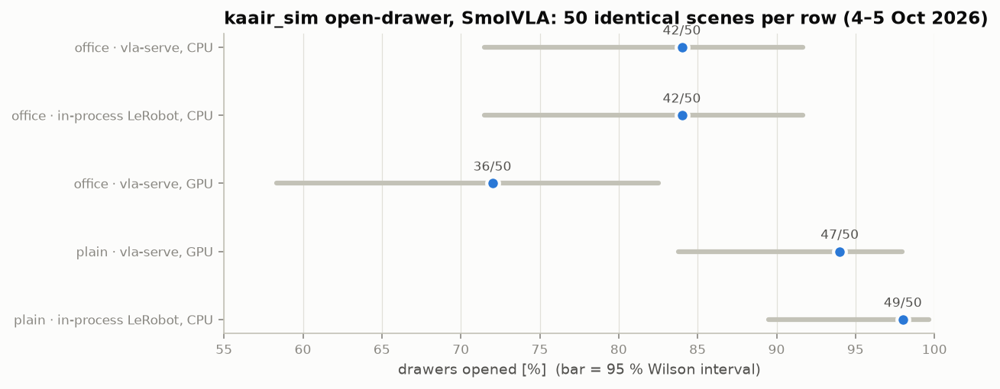

# Test in simulation

Matching LeRobot number-for-number proves the *server* is right. It does not prove the *policy*
works on your setup. For that you need closed-loop runs: the policy acts, the world changes, the
policy sees the result. Simulation lets you do hundreds of those before risking hardware.

## The pattern

Keep your simulator's own evaluation loop — scenes, seeds, success criterion — and swap only the
policy for an HTTP call. Then "served vs in-process" is the only thing that differs.

```python
class ServedPolicy:
    """Stands in for (policy, pre, post) inside an existing LeRobot-style eval loop."""
    def __init__(self, client):
        self.client, self.queue = client, []

    def reset(self):                               # start of each episode
        self.queue.clear(); self.client.reset()

    def select_action(self, obs):                  # same semantics as LeRobot's select_action
        if not self.queue:
            chunk = self.client.act(**obs)
            self.queue = list(chunk.actions[: chunk.n_action_steps])
        return self.queue.pop(0)
```

A simulator usually pauses physics while the policy thinks (synchronous), so latency cannot
change the outcome: what you measure is the served policy alone.

## Worked example: kaair_sim, open the drawer

[`examples/kaair_sim_eval.py`](https://github.com/mtbui2010/vla-serve/blob/main/examples/kaair_sim_eval.py)
does exactly this for a MuJoCo kitchen-cabinet task with a SmolVLA policy.

```bash
# office scene (photo textures, multi-drawer policy)
CK=smolvla_open_drawer_real500_multidrawer_20260928/checkpoints/020000/pretrained_model
make docker-run GPU=3 CKPT_ROOT=/mnt/nas/lerobot_shared/kaair_sim/checkpoints MODEL=/ckpt/$CK
make kaair-eval KAAIR_CKPT=$CK KAAIR_TASK=task_open_drawer.yaml \
  KAAIR_RAND=randomization_real.yaml KAAIR_EXTRA=--camera-model N=50

# plain scene (single-drawer policy): the defaults
make kaair-eval KAAIR_CKPT=smolvla_open_drawer_500_20260924/checkpoints/020000/pretrained_model
```

Add `--device cpu` to the server (`docker run … serve --host 0.0.0.0 --device cpu <model>`) to
compare with an in-process run on CPU, device for device.

!!! measured "Measured (2026-10-04/05)"
    

    **Office scene** (textures from photos of the real room, multi-drawer SmolVLA, camera model on):

    | run | drawers opened |
    |---|---|
    | vla-serve, policy on **CPU** | **42 / 50** |
    | in-process LeRobot, policy on **CPU** | **42 / 50** |
    | vla-serve, policy on GPU | 36 / 50 |
    | vla-serve, CPU, **client resize + JPEG q95 4:4:4** (the client default) | **44 / 50** |

    On the same device the two are indistinguishable: 3 scenes only one of them solved, 3 only
    the other (paired test p = 1.0), and the same five hard scenes failed in both. The GPU run is
    lower but not significantly so against the CPU run (p = 0.11). With identical noise the GPU
    and CPU chunks differ by at most 0.018 rad, while a different noise draw moves them by up to
    0.48 rad, so which noise each episode happens to draw dominates.

    **Plain scene** (single-drawer SmolVLA): 47/50 through vla-serve (GPU) vs 49/50 in-process
    (CPU), p = 0.62. Its hardest scene (seed 4) failed 5/5 in-process when re-run alone.

## Read results honestly

* **Compare against a baseline you ran today**, on the same scenes. A number from last month was
  produced by last month's simulator code.
* **Seed the policy's noise per episode** if you want paired comparisons. Flow-matching policies
  draw random noise for every chunk; if the evaluator does not seed it, an episode's outcome
  depends on how many random numbers the previous episodes consumed. See
  [Evaluating a policy](../learn/07-evaluation.md).
* **50 episodes cannot separate 94 % from 98 %.** Report counts and an interval, not just a
  percentage.
