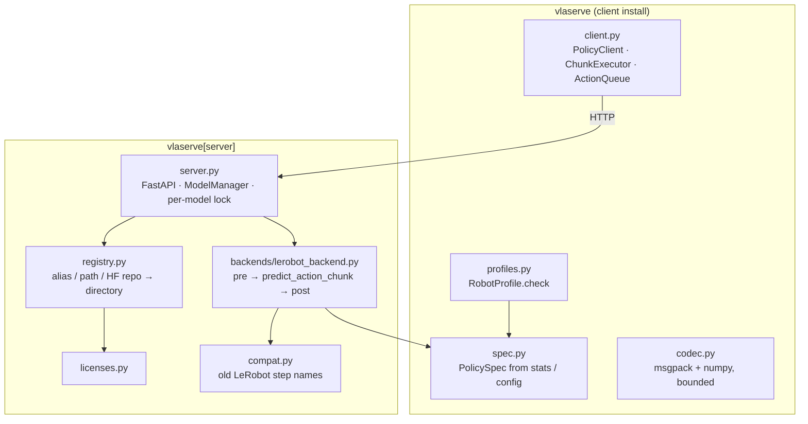

# How it works

## The pieces

Everything in the left box imports nothing heavier than numpy, so a robot computer installs it
in seconds (`tests/test_client_is_light.py` proves it by making torch unimportable).

## One request, end to end

1. **Client** packs frames (H×W×3 `uint8`, raw), state and task with msgpack and `POST`s
   `/v1/act`.
2. **Codec** checks every array header before allocating: dtype on an allowlist, at most 4
   dimensions, byte length equal to shape × itemsize, body ≤ 64 MB.
3. **Spec** validates the observation against what the checkpoint needs: every camera present,
   no unknown camera, 3 channels, state length, no NaN/Inf, a task for language policies. A
   mistake is a `400` with the reason — never a `500`, never GPU time.
4. **Server** takes the model's lock and runs the backend in a worker thread, so `/health`
   keeps answering during a 300 ms inference. It never starts GPU work for a client that has
   already disconnected.
5. **Backend** converts frames to `1×C×H×W` floats in [0, 1] (no resize), runs LeRobot's own
   preprocessor (rename, tokenise, normalise, move to GPU), calls `predict_action_chunk`, then
   the postprocessor **per step** (unnormalise, relative→absolute), exactly like LeRobot's
   policy server.
6. The chunk goes back as a `float32` array `(H, D)` with timings.

## Decisions, and why

| Decision | Why |
|---|---|
| Python, LeRobot as the backend | Each new VLA family would otherwise need its own export and a hand-written tokenizer/normaliser. LeRobot already implements ~20 policies with self-describing checkpoints. A Go/ONNX-only design (like VisionServe) was considered and rejected for this reason. |
| The checkpoint is the manifest | `config.json` + processor JSON + statistics describe everything; nobody writes a manifest by hand. |
| Statistics before `config.json` | `config.json` can be stale after fine-tuning; the statistics are computed from the training data itself. See [chapter 5](../learn/05-checkpoints.md). |
| No server-side resize | Training feeds frames as recorded; the policy resizes internally. Resizing to a stale declared shape distorts the image. |
| Eager PyTorch by default | Some checkpoints ship `torch.compile` with `max-autotune`: first call ≈ 46 s and kernel choices vary run to run (≈ 1e-3 differences in bf16). Opt in per model. |
| Return whole chunks; timing on the client | The server stays a simple request/response service; the robot side owns the clock. |
| Licences recorded, not enforced | It serves your own checkpoints; the point is knowing what you ship. |
