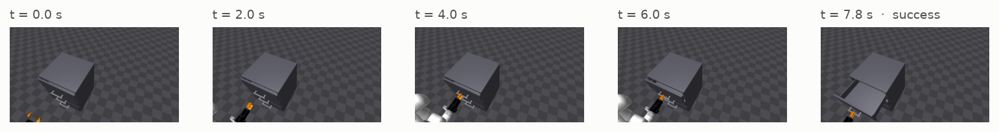

---
hide:
  - navigation
---

# vla-serve

**Serve a trained Vision-Language-Action policy with one command, and drive a robot with it.**

You train a robot policy with [LeRobot](https://github.com/huggingface/lerobot) — pi0.5,
SmolVLA, or any other policy it supports. vla-serve turns that checkpoint into an HTTP service:
send camera frames, joint positions and a sentence such as *"open the drawer"*, get back the
next second or two of robot actions. The robot-side client then plays those actions at a steady
rate while the next ones are being computed.


<small>A real run: SmolVLA served by vla-serve opens a drawer in the kaair_sim MuJoCo scene in
7.8 s — 6 requests to the server, 265 motor commands.</small>

It is the sibling of [VisionServe](https://mtbui2010.github.io/vision_serve/) ("Ollama for
computer vision") for robot policies. Free, open source (Apache-2.0), local, no account.

## In one minute

```bash
# GPU machine: start the server (container, checkpoint mounted read-only)
docker run -d --gpus all -p 127.0.0.1:11450:11450 \
  -v ~/.cache/huggingface:/root/.cache/huggingface \
  -v /data/runs:/ckpt:ro \
  vla-serve:gpu-cu128 serve --host 0.0.0.0 /ckpt/my_run/checkpoints/last/pretrained_model
```

```python
# Robot computer: pip install vla-serve   (≈ 80 MB, no torch)
from vlaserve.client import PolicyClient, ChunkExecutor

client = PolicyClient("http://gpu-box:11450", model="/ckpt/my_run/checkpoints/last/pretrained_model")
chunk = client.act(images={"head": head_rgb, "wrist": wrist_rgb}, state=q, task="open drawer")
chunk.actions.shape            # (50, 8): the next 50 steps, 8 numbers each, in robot units

ChunkExecutor(client, get_observation=read_robot, send_action=robot.command, fps=30).run(
    task="open drawer", seconds=60)
```

## What it takes off your hands

| When you deploy a VLA yourself… | vla-serve |
|---|---|
| every policy family has its own loading code, tokenizer and normalisation statistics | reads all of it from the **checkpoint itself** — no config file to write |
| a checkpoint saved by an older LeRobot stops loading after an upgrade | loads it anyway, without touching the files |
| `config.json` says one thing and the dataset another (very common after fine-tuning) | trusts the dataset statistics, so the right cameras and sizes are used |
| the robot's camera names or joint count don't match training, and nothing complains | `vla-serve check` refuses before the robot moves |
| inference (≈ 300 ms) is slower than one control step (33 ms at 30 Hz) | the client keeps a queue, asks early, drops actions that went stale |
| "is the served policy really the same as in training?" | tested **bit for bit** against LeRobot, and closed-loop in simulation |
| "which licence am I shipping?" | every model reports one; PaliGemma derivatives are flagged |

## Verified so far

| policy | checkpoint | result |
|---|---|---|
| pi0.5 | `lerobot/pi05_libero_finetuned` | chunks identical to LeRobot's own policy server |
| pi0.5 | KETI OpenArm handover (bimanual, 16 joints) | identical; needed the old-version compatibility layer |
| SmolVLA | kaair_sim open-drawer (MuJoCo) | identical to in-process LeRobot; **47/50** drawers opened through the server vs 49/50 in-process (within noise) |

## Learn VLAs here

The [Learn VLAs](learn/index.md) section is a course built on this repository: what a VLA is,
why it outputs *chunks* of actions, how flow matching turns noise into motion, why the
normalisation statistics matter more than `config.json`, and how to evaluate a policy without
fooling yourself. Every chapter points at real code and real measurements from these models.

## Status

Works on x86 Linux with an NVIDIA GPU. Not yet: Jetson images, compressed (JPEG) transport,
a ROS 2 node, runs on a physical robot. See the
[handoff notes](https://github.com/mtbui2010/vla-serve/blob/main/HANDOFF.md).
