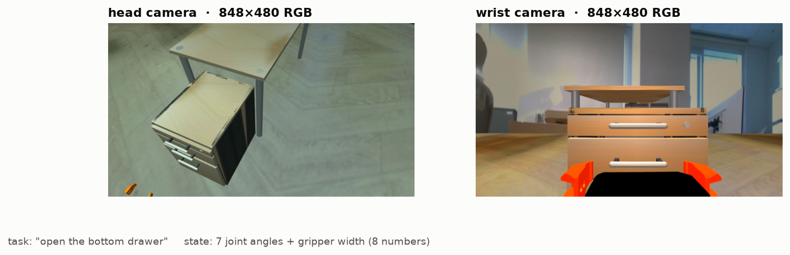
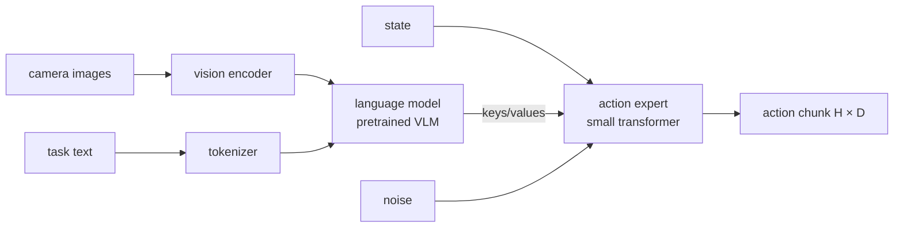

# 1. What a VLA is

!!! abstract "In this chapter"
    - A VLA is a robot policy: observation in, actions out.
    - It is built by attaching an *action head* to a pretrained vision-language model.
    - How the policies you will meet in this repo — pi0.5, SmolVLA — are put together.

## A policy, with language

A robot **policy** \(\pi\) maps what the robot senses to what it should do:

\[
a_t \sim \pi(\,\cdot \mid o_t,\ \ell\,)
\]

where \(o_t\) is the observation at time \(t\) (camera images and joint state) and \(\ell\) is an
instruction such as *"open the drawer"*. A **Vision-Language-Action model** is a policy whose
backbone is a **vision-language model (VLM)** — a network pretrained on huge amounts of web images
and text — so it inherits that model's ability to recognise objects and follow instructions.

Concretely, for kaair_sim's open-drawer SmolVLA served in this repo — a real observation from a
simulated episode in the office scene, whose textures come from photos of the real room:

| | shape | what it is |
|---|---|---|
| `head` image | 480 × 848 × 3 | RGB from the head camera |
| `wrist` image | 480 × 848 × 3 | RGB from the wrist camera |
| `state` | 8 | 7 arm joint angles + gripper width |
| `task` | text | "open drawer" |
| **output** | 50 × 8 | the next 50 actions, each 7 joint targets + gripper width |

## How the network is built

1. **Vision encoder** turns each image into a sequence of patch tokens.
2. **Language model** reads image tokens and text tokens together. This is the pretrained VLM;
   it supplies "what is in the scene and what was asked".
3. **Action head** turns that understanding into numbers. In pi0/pi0.5 and SmolVLA this is a
   separate, smaller transformer — the **action expert** — that attends to the VLM's internal
   states and outputs a whole chunk of actions. How it does that is
   [chapter 3](03-action-heads.md).

The VLM is the expensive part; the action expert is small but runs several times per chunk.

## The policies in this repo

Values below are read from the checkpoints' own `config.json` files.

| | pi0.5 (LeRobot port of openpi) | SmolVLA |
|---|---|---|
| VLM | PaliGemma, `gemma_2b` language model | SmolVLM2-500M, cut to **16** layers (`num_vlm_layers`) |
| action expert | `gemma_300m` | transformer at 0.75× VLM width (`expert_width_multiplier`) |
| action head | flow matching, 10 integration steps | flow matching, 10 steps (`num_steps`) |
| image size the network sees | 224 × 224 (`image_resolution`) | 512 × 512 with padding (`resize_imgs_with_padding`) |
| prompt length | up to 200 tokens | up to 48 tokens |
| chunk | 50 (LIBERO), 30 (KETI OpenArm) | 50 |
| weights licence | Gemma Terms (PaliGemma derivative) | check the model card |

Other families you will see in papers:

* **OpenVLA** ([Kim et al., 2024](https://arxiv.org/abs/2406.09246)) — a 7 B Llama 2-based VLM
  that writes actions as *tokens*, like words (chapter 3).
* **GR00T N1** ([NVIDIA, 2025](https://arxiv.org/abs/2503.14734)) — a VLM plus a diffusion
  transformer action head, aimed at humanoids.
* **pi0** ([Black et al., 2024](https://arxiv.org/abs/2410.24164)) — introduced the
  VLM + flow-matching action expert design that pi0.5 and SmolVLA
  ([Shukor et al., 2025](https://arxiv.org/abs/2506.01844)) follow.

## How it is trained

By **imitation learning** (behaviour cloning): people teleoperate the robot, every frame of
camera images, joint state and the operator's command is recorded, and the network learns to
predict the recorded actions from the recorded observations. Demonstrations can also come from a
scripted expert in simulation: the policy above was trained on `kaair_sim_open_drawer_real500`,
500 episodes (168 000 frames at 30 Hz) generated by kaair_sim's `gen_dataset.py` with its scripted
`expert_open_drawer.py`.

The VLM starts pretrained; fine-tuning can update everything or only part. The kaair SmolVLA
froze the vision encoder (`freeze_vision_encoder: true`) and trained only the action expert
(`train_expert_only: true`).

## What this means when you deploy

* The policy only knows the **cameras, joints and phrasing** it was trained with. Change a camera
  position or rename a joint order and it may fail silently — hence `vla-serve check`.
* Most compute is the VLM forward pass, so model size drives latency: about 300 ms per chunk for
  pi0.5 on an RTX A6000 in this repo.
* The VLM decides the licence: a PaliGemma-based policy inherits the Gemma Terms.

**Next:** [Actions and action chunks →](02-actions-and-chunks.md)
