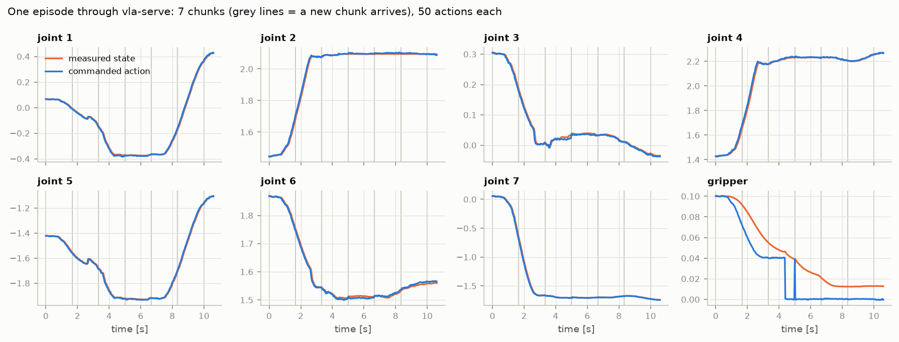

# 2. Actions and action chunks

!!! abstract "In this chapter"
    - What the numbers in an action mean, absolute vs relative.
    - Why VLAs predict a *chunk* of future actions instead of one.
    - `chunk_size` vs `n_action_steps`, and how long a chunk lasts in seconds.

## What an action is

An action is a vector of **targets for the robot's low-level controller**, one per control step.
Which targets is decided by the dataset, and the checkpoint records their names:

```text
KETI OpenArm (16):  right_joint_1.pos … right_joint_7.pos, right_gripper.pos,
                    left_joint_1.pos  … left_joint_7.pos,  left_gripper.pos
kaair drawer  (8):  joint1 … joint7 (radians), gripper width (metres, clipped to 0–0.1)
```

The robot's own controller (a position servo, an impedance controller…) then moves toward each
target. The policy never commands torques directly in these setups.

### Absolute or relative

* **Absolute**: "go to joint angle 1.41 rad". Used by the kaair drawer policy.
* **Relative** (delta): "move 0.02 rad from where you are now". The KETI OpenArm pi0.5 uses this
  (`use_relative_actions: true`), except for the grippers (`relative_exclude_joints: [gripper]`).

With relative actions, the model is trained on \(a - s\) (action minus current state) for the
masked joints, and at inference the state is added back:

\[
a^{\text{abs}}_i = a^{\text{rel}}_i + s_i \quad \text{for every joint } i \text{ not excluded}
\]

In LeRobot this is a pair of processor steps: `relative_actions_processor` in the preprocessor
remembers the state it saw, and `absolute_actions_processor` in the postprocessor adds it back.
They must run as a pair, on the same observation — one reason vla-serve holds a per-model lock
around the whole pre → model → post sequence.

!!! code "Where in the code"
    `lerobot/processor/relative_action_processor.py` — `RelativeActionsProcessorStep` caches
    `observation.state`; `AbsoluteActionsProcessorStep` reads it back.
    vla-serve's `compat.py` exists because LeRobot 0.5 called the first one
    `delta_actions_processor`.

## Why chunks

Early imitation policies predicted one action per observation. Two problems:

1. **Compounding error.** Each small mistake moves the robot into a state slightly unlike the
   training data, where the next prediction is a bit worse, and so on.
2. **Inconsistent decisions.** Human demonstrations are multimodal (go left of the obstacle, or
   right). Predicting step by step, the policy can switch mode mid-motion and jitter.

**Action chunking** — introduced for robot imitation by ACT
([Zhao et al., 2023](https://arxiv.org/abs/2304.13705)) — predicts the next \(H\) actions at
once and executes several of them before looking again. The trajectory inside a chunk is
coherent, the number of decisions per second drops, and a slow model is called less often.

## `chunk_size` and `n_action_steps`

Two numbers in every checkpoint config:

* `chunk_size` \(H\): how many actions the model outputs.
* `n_action_steps`: how many of them are executed before asking again.

| checkpoint | `chunk_size` | `n_action_steps` | control rate | one chunk lasts |
|---|---:|---:|---:|---:|
| `pi05_libero_finetuned` | 50 | 50 | 20 Hz (robosuite default) | 2.5 s |
| KETI OpenArm handover | 30 | 30 | 30 Hz (assumed) | 1.0 s |
| kaair SmolVLA drawer | 50 | 50 | 30 Hz | 1.67 s |

Executing fewer than \(H\) steps (`n_action_steps < chunk_size`) makes the robot more reactive
at the cost of more inference calls. Executing all of them is pure open loop for that long: if
the drawer handle slips during those 1.67 s, the policy will not notice until the next chunk.

A real episode served by vla-serve: seven chunks of 50 actions, each joint's commanded target
(blue) and measured position (orange):



!!! measured "Measured"
    The kaair drawer evaluation runs 30 Hz with 50-step chunks: 309 inference calls for 50
    episodes of up to 15 s — about six calls per episode.

## What this means when you deploy

* Your control loop must run at the **rate the data was recorded at**; actions are spaced for it.
* The action vector order is fixed by training. Check `action_names` against your driver's joint
  order (`vla-serve check` does when both sides list them).
* With relative actions, a wrong state reading corrupts every action of the chunk.

**Next:** [How the action head works →](03-action-heads.md)
