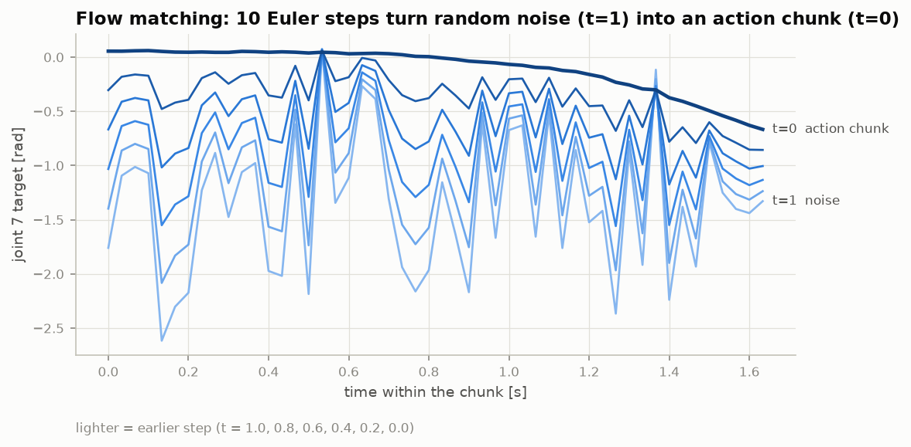
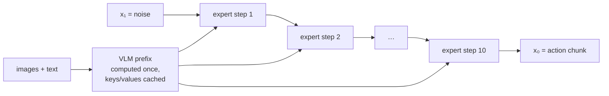
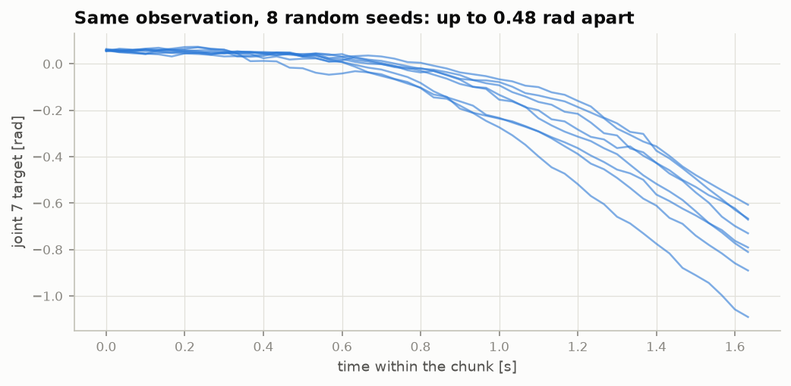

# 3. How the action head works

!!! abstract "In this chapter"
    - Two ways to get numbers out of a language model: action *tokens*, or *flow matching*.
    - Flow matching step by step, on the real pi0.5 code.
    - Why the same observation gives different actions, and what that means for testing.

## Option A: actions as tokens

A language model outputs tokens. The simplest way to make it output actions is to turn actions
into tokens: split each action dimension's range into 256 bins and give each bin a token.
OpenVLA does this — a 7-dimensional action becomes 7 tokens, generated one after another like
words ([Kim et al., 2024](https://arxiv.org/abs/2406.09246)).

It reuses the language model unchanged, but generating 50 steps × 8 dimensions = 400 tokens one at
a time is slow, and binning loses precision. **FAST**
([Pertsch et al., 2025](https://arxiv.org/abs/2501.09747)) compresses a whole chunk with a
discrete cosine transform before tokenising, so far fewer tokens are needed; pi0-FAST uses it.

## Option B: flow matching

pi0, pi0.5 and SmolVLA instead treat the chunk as a continuous \(H \times D\) array and *generate*
it, the way image diffusion models generate pictures — starting from noise and refining.

### Training

Take a real chunk \(A\) from the dataset and random noise \(\varepsilon \sim \mathcal{N}(0, I)\) of
the same shape. Pick a time \(t \in (0, 1)\) and mix them:

\[
x_t = t\,\varepsilon + (1 - t)\,A
\]

At \(t = 1\) this is pure noise, at \(t = 0\) the real actions. The network \(v_\theta\) is
trained to predict the direction from actions to noise, \(u_t = \varepsilon - A\), given
\(x_t\), \(t\) and the observation:

\[
\mathcal{L} = \big\| v_\theta(x_t, t \mid o, \ell) - (\varepsilon - A) \big\|^2
\]

!!! code "Where in the code — `lerobot/policies/pi05/modeling_pi05.py`, `forward`"
    ```python
    x_t = time_expanded * noise + (1 - time_expanded) * actions
    u_t = noise - actions
    ```

### Inference

Start from noise at \(t = 1\) and walk toward \(t = 0\) by following the predicted velocity
with \(N\) Euler steps (\(\Delta t = -1/N\)):

\[
x_{t+\Delta t} = x_t + \Delta t \cdot v_\theta(x_t, t \mid o, \ell)
\]

After \(N = 10\) steps (`num_inference_steps` for pi0.5, `num_steps` for SmolVLA) the result is
the action chunk. LeRobot calls this `euler_integrate` in `policies/common/flow_matching.py`.

Recorded on a real kaair observation — the wrist joint's 50 targets after 0, 2, 4, 6, 8 and 10
steps:





The expensive VLM runs **once** per chunk; its keys and values are cached and the small action
expert runs ten times. That is why the "VLM + small expert" split exists.

## Why the same input gives different actions

The starting noise is random. Two different noise samples lead to two different, equally
plausible trajectories — this is how the model represents that demonstrations disagree (left
or right of the obstacle).



!!! measured "Measured"
    kaair SmolVLA, the first observation of a real episode, eight seeds: the wrist joint's
    target differs by up to about **0.5 rad** between seeds. With the *same* seed, the served and
    the in-process chunk are identical to the last bit.

Consequences:

* **To compare two implementations, fix the noise.** vla-serve's `/v1/act` accepts a `seed`;
  the parity tests use it. Without it, "different output" proves nothing.
* **Evaluation outcomes vary with the noise.** One scene in the kaair evaluation failed 5/5 runs
  from a fresh process but succeeded inside a longer run, where earlier episodes had advanced the
  random generator. See [chapter 7](07-evaluation.md).

## What this means when you deploy

* Latency ≈ one VLM pass + \(N\) expert passes. Fewer steps is faster and usually a little worse;
  measure before changing \(N\).
* Exporting a flow-matching policy to ONNX/TensorRT means unrolling the \(N\)-step loop and
  passing the noise in as an input ([chapter 8](08-deployment.md)).

**Next:** [Normalisation and statistics →](04-normalisation.md)
