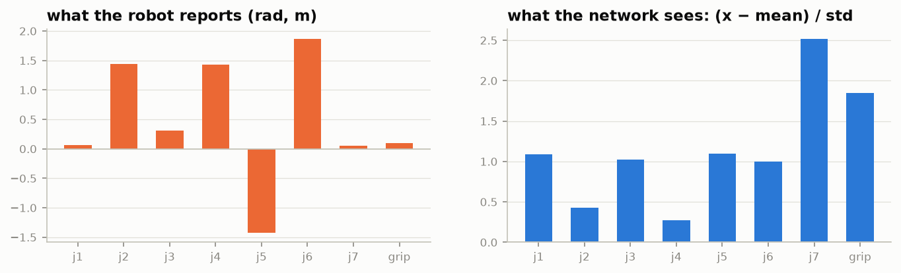

# 4. Normalisation and statistics

!!! abstract "In this chapter"
    - The network never sees radians or metres; it sees normalised numbers.
    - The two schemes in this repo's checkpoints, with their formulas.
    - Why the statistics file is the most trustworthy description of a checkpoint.

## Why normalise

Joint angles might span ±3 rad, a gripper 0–0.1 m, a lift 0.1–0.6 m. Fed raw, the network would
weigh big-range dimensions more and train poorly. So every state and action dimension is mapped to
a common range using **statistics computed from the training dataset**, and actions are mapped
back after the network.

## The two schemes you will meet

The checkpoint's `normalization_mapping` says which applies to what:

| checkpoint | `STATE` | `ACTION` | `VISUAL` |
|---|---|---|---|
| kaair SmolVLA drawer | `MEAN_STD` | `MEAN_STD` | `IDENTITY` |
| `pi05_libero_finetuned` | `MEAN_STD` | `MEAN_STD` | `IDENTITY` |
| KETI pi0.5 OpenArm | `QUANTILES` | `QUANTILES` | `IDENTITY` |

**MEAN_STD** — zero mean, unit variance:

\[
\hat x = \frac{x - \mu}{\sigma + \epsilon}, \qquad x = \hat x\,\sigma + \mu \quad (\epsilon = 10^{-8})
\]

**QUANTILES** — the 1st and 99th percentiles go to −1 and +1:

\[
\hat x = 2\,\frac{x - q_{01}}{q_{99} - q_{01}} - 1, \qquad x = \frac{(\hat x + 1)(q_{99} - q_{01})}{2} + q_{01}
\]

The first observation of a real kaair episode, before and after `MEAN_STD`:



Quantiles ignore the most extreme 1 % on each side, so a few outlier frames in the dataset do not
squash everything else.

**IDENTITY** for images: the policy does its own image handling (resize with padding, scaling
to the range its vision encoder expects).

!!! code "Where in the code"
    `lerobot/processor/normalize_processor.py` — the `QUANTILES` branch is literally
    `2.0 * (tensor - q01) / denom - 1.0` and its inverse `(tensor + 1.0) * denom / 2.0 + q01`.

## Where the statistics live

In the checkpoint, as a small safetensors file next to the processor configuration:

```text
policy_preprocessor_step_5_normalizer_processor.safetensors
  observation.state.mean   (8,)     observation.state.std   (8,)
  action.mean              (8,)     action.std              (8,)
  observation.images.head.mean   (3,1,1)   …   (+ min, max, q01…q99 for each)
```

Two things follow:

1. **The statistics belong to the checkpoint, not the robot.** Retrain on a different dataset and
   they change. Never reuse statistics from another run.
2. **The statistics name the dataset's own features.** Here: `head`, `wrist`, an 8-dimensional
   state. That is the ground truth of what the policy was trained on.

## A real case: `config.json` disagreed with the statistics

The kaair SmolVLA was fine-tuned from `lerobot/smolvla_base`. Its `config.json` still described the
base model's inputs; its statistics described the real dataset:

| | `config.json` | statistics |
|---|---|---|
| cameras | `camera1`, `camera2`, `camera3` (256 × 256) | `head`, `wrist` |
| state size | 6 | **8** |

A `rename_map` in the preprocessor (`head → camera1`, `wrist → camera2`) bridged the gap, so
training and LeRobot's own evaluation worked. But any tool that believed `config.json` would ask
the robot for the wrong cameras and state size — and LeRobot's async policy server would resize
the 480 × 848 frames to 256 × 256, distorting them.

!!! measured "What vla-serve does"
    It reads the statistics first (just the safetensors *header*, a few kB, no tensors loaded),
    then falls back to `config.json`. `vla-serve inspect` on this checkpoint reports
    `cameras: head, wrist · state 8 · source: stats`.

## What this means when you deploy

* A wrong scale is silent: the network still outputs numbers, the arm still moves. Unit tests on
  shapes will not catch it.
* If a state dimension is constant in the dataset, its \(\sigma\) is tiny and any sensor noise is
  hugely amplified after normalisation. Look at the statistics before deploying.
* Images are passed at the resolution the camera gives; the policy resizes them itself.

**Next:** [Anatomy of a LeRobot checkpoint →](05-checkpoints.md)
