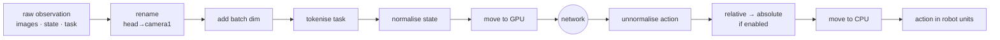

# 5. Anatomy of a LeRobot checkpoint

!!! abstract "In this chapter"
    - What each file in a checkpoint directory does.
    - The *processor pipelines* that sit around the network.
    - Two real ways checkpoints break, and how vlaserve handles them.

## The directory

```text
pretrained_model/
├── config.json                                   which policy class, its hyper-parameters
├── model.safetensors                             the weights (0.9 GB SmolVLA … 8 GB pi0.5)
├── policy_preprocessor.json                      steps applied before the network
├── policy_preprocessor_step_5_normalizer_processor.safetensors    dataset statistics
├── policy_postprocessor.json                     steps applied after the network
├── policy_postprocessor_step_0_unnormalizer_processor.safetensors
└── train_config.json                             how it was trained (dataset, optimiser, …)
```

Everything needed to *use* the model is here. That is why vlaserve needs no manifest: the
checkpoint is the manifest.

## The pipeline around the network



The real step lists, read from the files:

=== "kaair SmolVLA"

    ```text
    preprocessor:  rename_observations_processor  {head→camera1, wrist→camera2}
                   to_batch_processor
                   smolvla_new_line_processor
                   tokenizer_processor            SmolVLM2-500M-Video-Instruct, 48 tokens
                   device_processor
                   normalizer_processor           MEAN_STD
    postprocessor: unnormalizer_processor, device_processor
    ```

=== "KETI pi0.5 OpenArm"

    ```text
    preprocessor:  rename_observations_processor  {}
                   to_batch_processor
                   delta_actions_processor        exclude gripper   (LeRobot 0.5 name)
                   normalizer_processor           QUANTILES
                   pi05_prepare_state_tokenizer_processor_step
                   tokenizer_processor            paligemma-3b-pt-224, 200 tokens
                   device_processor
    postprocessor: unnormalizer_processor, absolute_actions_processor, device_processor
    ```

!!! code "Where in the code"
    vlaserve loads both pipelines with LeRobot's own
    `make_pre_post_processors(cfg, pretrained_path=...)` in
    [`backends/lerobot_backend.py`](https://github.com/mtbui2010/vlaserve/blob/main/vlaserve/backends/lerobot_backend.py),
    so every step above runs exactly as in training.

## Break 1 — a renamed step

LeRobot 0.6 renamed `delta_actions_processor` to `relative_actions_processor`. The KETI
checkpoint, saved with 0.5, then fails to load:

```text
Processor step 'delta_actions_processor' not found in registry.
```

vlaserve's [`compat.py`](https://github.com/mtbui2010/vlaserve/blob/main/vlaserve/compat.py)
registers the old name as a subclass of the new step (after checking both take identical
settings). The files on disk are never modified.

## Break 2 — a stale `config.json`

Covered in [chapter 4](04-normalisation.md): after fine-tuning from a base model, `config.json`
can still describe the base model's inputs. The `rename_map` and the statistics are the truth.

!!! code "Where in the code"
    [`spec.py`](https://github.com/mtbui2010/vlaserve/blob/main/vlaserve/spec.py) builds the
    `PolicySpec` — camera names, state and action sizes — from the statistics file's
    **header only** (8-byte length + JSON, a few kB), then falls back to `config.json`.
    Run `vlaserve inspect <checkpoint>` to see the result.

## What this means when you deploy

* Copy the **whole** directory. Weights without the processor files are unusable.
* Pin the LeRobot version you trained with, or test loading with the version you serve with.
* When `config.json` and `vlaserve inspect` disagree, believe `inspect` (`source: stats`).

**Next:** [Real-time control →](06-real-time.md)
