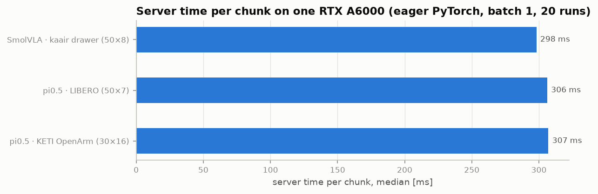
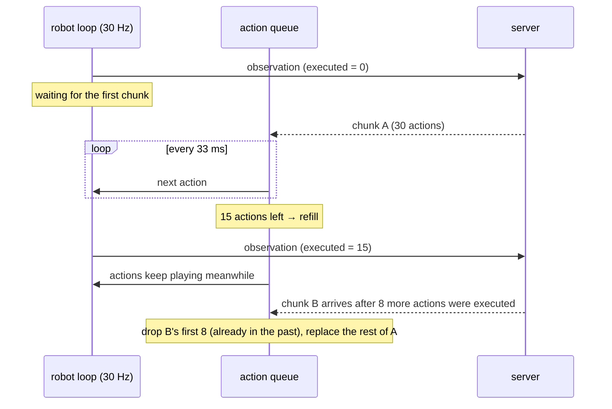
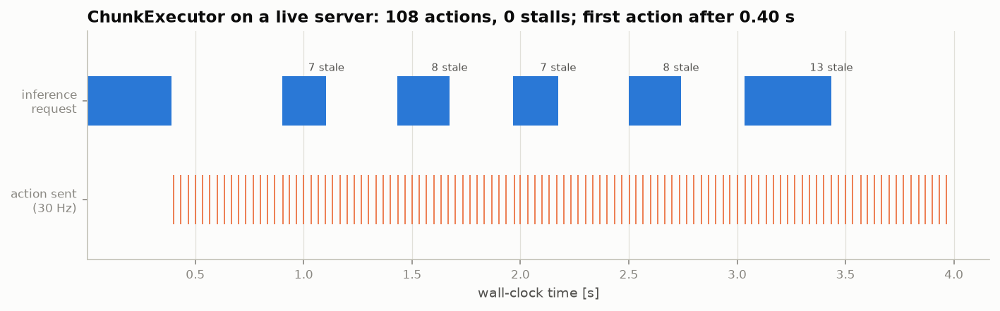

# 6. Real-time control

!!! abstract "In this chapter"
    - Why a 300 ms model can still drive a 30 Hz robot.
    - The executor's queue, and why stale actions must be dropped.
    - A real timeline recorded against a live server.

## The mismatch

A 30 Hz robot needs a new action every 33 ms. One chunk takes a few hundred milliseconds:

Calling the policy at every step is impossible. Chunks make it possible: one call yields 30–50
actions, i.e. one to two seconds of motion.

## Two ways to execute chunks

**Synchronous** — stop, think, act: request a chunk, play all of it, stop, request the next.
Simple, and exactly what simulators do (physics is paused while the model thinks). On a real
robot the arm freezes for the inference time at every chunk boundary.

**Asynchronous** — keep moving while thinking: request the next chunk *while* the current one
is still playing. This is what `ChunkExecutor` does.

## Stale actions

Chunk B was planned from an observation taken when 15 actions had been executed. By the time it
arrives, 8 more have run. B's first 8 actions describe moves the robot has **already made** —
replaying them would jerk it backwards. So they are dropped:

\[
\text{drop} = \text{executed}_{\text{now}} - \text{executed}_{\text{at observation}}
\]

Counting **executed actions**, not clock ticks, matters. While the robot stands still (waiting for
the very first chunk), time passes but the robot does not move, so the observation is still
current. An earlier version of `ActionQueue` counted ticks and threw away the whole first chunk
after a slow warm-up; the end-to-end test caught it.

!!! measured "Measured — the run above"
    SmolVLA (office-scene checkpoint) on the server, stub robot at 30 Hz for 4 s, 30 actions per
    chunk, refill at 15: 120 ticks (12 waiting for the first chunk, then 108 actions sent),
    **0 stalls**, 6 chunks, 38 stale actions dropped (≈ 7–8 per chunk ≈ 0.24 s round trip × 30 Hz).

!!! code "Where in the code"
    [`client.py`](https://github.com/mtbui2010/vlaserve/blob/main/vlaserve/client.py):
    `ActionQueue.on_chunk` (pure logic, unit-tested without clocks) and `ChunkExecutor.run`
    (two threads: the fixed-rate control loop and the inference requester).

## Choosing the two knobs

* **`refill_at`** (when to ask): must be larger than *latency × fps* or the queue runs dry. At
  0.24 s and 30 Hz that is about 7; with a busier GPU (0.4 s) it is 12. The default, half a
  30-step chunk, is 15.
* **`execute_steps`** (how much of each chunk to use): smaller is more reactive and costs more
  calls.

## Smoother switching

The executor's rule is *latest chunk wins*: the new chunk replaces what is left of the old one.
At the switch the target can jump a little, because the two chunks were sampled from different
noise ([chapter 3](03-action-heads.md)). Two known refinements:

* **Temporal ensembling** (ACT, [Zhao et al., 2023](https://arxiv.org/abs/2304.13705)) averages
  all chunks' predictions for the same time step.
* **Real-time chunking** ([Black et al., 2025](https://arxiv.org/abs/2506.07339)) makes the new
  chunk agree with the actions still queued, by guiding the flow-matching sampler. LeRobot ships
  an implementation in `policies/rtc/`.

Either would replace one function, `ActionQueue.on_chunk`.

## What this means when you deploy

* Measure round-trip time on the real network, then set `refill_at` above latency × fps.
* `RunStats.stalls` should be 0. If it is not, the robot is pausing.
* On one machine the HTTP layer costs ≈ 12 ms per chunk (measured over 19 chunks), about 3–4 %
  of inference. Over a network, frame size dominates: two raw 480×848 frames are 2.44 MB, which is
  why the client resizes to the network input and sends JPEG by default (~97 kB). Check that
  compression does not change your policy's actions: compare chunks with `encoding="raw"` for the
  same seed, relative to the spread across seeds (≤ 0.09× on the measured SmolVLA; 4:2:0 chroma
  subsampling at quality 90 was 1.0×).

**Next:** [Evaluating a policy →](07-evaluation.md)
